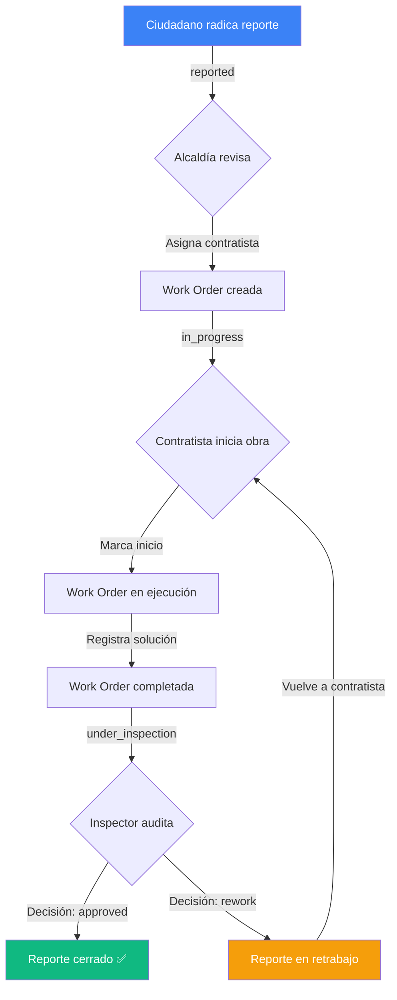

---

# 🏛️ Vigía Ciudadano

**Sistema integral de gestión de incidencias urbanas que conecta ciudadanos, contratistas e inspectores de calidad para resolver problemas de infraestructura pública de manera transparente y trazable.**

Vigía Ciudadano permite a los ciudadanos reportar incidencias como baches, fugas de agua, fallas en alumbrado público y más, siguiendo un ciclo de vida completo desde la radicación hasta la inspección de calidad de la obra realizada.

## 📋 Tabla de Contenidos

- [Características Principales](#-características-principales)
- [Arquitectura del Sistema](#-arquitectura-del-sistema)
- [Ciclo de Vida del Reporte](#-ciclo-de-vida-del-reporte)
- [Requisitos del Sistema](#-requisitos-del-sistema)
- [Instalación Local](#-instalación-local)
- [Variables de Entorno](#-variables-de-entorno)
- [Credenciales de Prueba](#-credenciales-de-prueba)
- [API REST - Especificación Completa](#-api-rest---especificación-completa)
- [Comandos de Desarrollo](#-comandos-de-desarrollo)
- [Estructura del Proyecto](#-estructura-del-proyecto)

---

## ✨ Características Principales

### 🎯 Para Ciudadanos
- **Radicación pública de reportes** sin necesidad de crear cuenta
- **Geolocalización precisa** con coordenadas GPS del incidente
- **Evidencia fotográfica** obligatoria del daño
- **Código de ticket único** (formato `REP-2026-XXXX`) para seguimiento
- **Suscripción a novedades** de reportes de interés
- **Consulta de incidencias cercanas** por radio geográfico

### 👷 Para Contratistas
- **Agenda de órdenes de trabajo** asignadas por la alcaldía
- **Registro de inicio y finalización** de obra
- **Evidencia fotográfica** de la solución implementada
- **Trazabilidad completa** del trabajo realizado

### 🔍 Para Inspectores de Calidad
- **Cola de inspecciones pendientes** priorizada por antigüedad
- **Checklist configurable** por categoría de daño
- **Decisión estructurada**: aprobación o retrabajo con justificación
- **Geolocalización del inspector** en el momento de la inspección
- **Foto de verificación** obligatoria

### 🏢 Para Alcaldía (Superadmin)
- **Dashboard operativo** con métricas en tiempo real
- **Despacho de incidencias** a contratistas
- **Gestión de cuadrillas** y asignación de departamentos
- **Control de SLA** por categoría de reporte

---

## 🏗️ Arquitectura del Sistema

### Stack Tecnológico

| Capa | Tecnología | Versión |
|------|-----------|---------|
| **Framework Backend** | Laravel | 12.x |
| **Lenguaje** | PHP | 8.2+ |
| **Base de Datos** | SQLite | 3.39+ |
| **Autenticación** | Laravel Sanctum | 4.3 |
| **Frontend** | Blade SSR + JavaScript | - |
| **CSS Framework** | Tailwind CSS | 4.0 |
| **Build Tool** | Vite | 7.0 |
| **Testing** | PHPUnit | 11.5 |

### Modelos de Dominio

```
┌─────────────────────────────────────────────────────────────┐
│                         DEPARTMENTS                          │
│  (Secretarías: Obras Públicas, Movilidad, Alumbrado, etc.) │
└────────────────────┬────────────────────────────────────────┘
                     │ 1:N
                     ▼
┌─────────────────────────────────────────────────────────────┐
│                         CATEGORIES                           │
│  (Baches, Fugas, Luminarias, etc. con SLA específico)       │
└────────────────────┬────────────────────────────────────────┘
                     │ 1:N
                     ▼
┌─────────────────────────────────────────────────────────────┐
│                          REPORTS                             │
│  (Incidencias ciudadanas con GPS, foto, ticket code)         │
└─────────┬──────────────────┬──────────────────┬─────────────┘
          │                  │                  │
          │ 1:N              │ 1:1              │ M:N
          ▼                  ▼                  ▼
┌─────────────────┐  ┌──────────────────┐  ┌──────────────┐
│   SUBSCRIBERS   │  │   WORK_ORDERS    │  │   REPORT     │
│ (Notificaciones)│  │ (Órdenes de      │  │  SUBSCRIBERS │
└─────────────────┘  │  trabajo)        │  └──────────────┘
                     └────────┬─────────┘
                              │ 1:N
                              ▼
                     ┌──────────────────┐
                     │    QUALITY       │
                     │  INSPECTIONS     │
                     │ (Auditoría)      │
                     └──────────────────┘
```

### Servicios de Dominio

| Servicio | Responsabilidad |
|----------|----------------|
| **ReportIntake** | Radicación de reportes: genera ticket code único, sube foto, valida coordenadas |
| **TicketCodeGenerator** | Genera códigos secuenciales `REP-AAAA-NNNN` con concurrencia segura |
| **ImageUploader** | Sube fotos a storage local/S3 con nombres únicos basados en hash |
| **WorkOrderDispatcher** | Asigna/reasigna órdenes de trabajo a contratistas |
| **WorkOrderExecution** | Gestiona transiciones de estado: `assigned` → `in_execution` → `completed` |
| **QualityInspectionRecorder** | Registra inspecciones y actualiza estados de reporte y orden atómicamente |

### Roles y Permisos

| Rol | Enum Value | Capacidades |
|-----|------------|-------------|
| **Ciudadano** | `citizen` | Radicar reportes, suscribirse a novedades, consultar trazabilidad |
| **Contratista** | `contractor` | Ver agenda, iniciar ejecución, completar obras con evidencia |
| **Inspector** | `quality_inspector` | Ver cola de inspecciones, aprobar/rechazar obras, geolocalizar inspección |
| **Superadmin** | `superadmin` | Dashboard, asignar órdenes, gestionar contratistas y categorías |

---

## 🔄 Ciclo de Vida del Reporte



### Estados del Reporte

| Estado | Descripción | Siguiente Paso |
|--------|-------------|----------------|
| `reported` | Recién radicado, pendiente de asignación | Alcaldía asigna contratista |
| `in_progress` | Orden de trabajo creada, contratista trabajando | Contratista completa obra |
| `under_inspection` | Obra terminada, esperando auditoría | Inspector aprueba/rechaza |
| `closed` | Obra aprobada, incidencia resuelta ✅ | - |
| `rework` | Obra rechazada, requiere ajustes | Contratista retrabaja |

### Estados de la Orden de Trabajo

| Estado | Descripción |
|--------|-------------|
| `assigned` | Orden asignada a contratista, pendiente de inicio |
| `in_execution` | Contratista trabajando en la obra |
| `completed` | Obra terminada, lista para inspección |

---

## 💻 Requisitos del Sistema

### Servidor de Desarrollo

- **PHP** >= 8.2 con extensiones:
  - Ctype
  - cURL
  - DOM
  - Fileinfo
  - JSON
  - Mbstring
  - OpenSSL
  - PDO
  - Tokenizer
  - XML
- **Composer** >= 2.5
- **Node.js** >= 18.x
- **npm** >= 9.x
- **SQLite** >= 3.39 (incluido en PHP por defecto)

### Opcional (para producción)

- **MySQL** >= 8.0 o **PostgreSQL** >= 14
- **Redis** para caché y colas
- **Servidor web** Nginx/Apache

---

## 🚀 Instalación Local

### 1. Clonar el Repositorio

```bash
git clone https://github.com/tu-usuario/vigia-ciudadano.git
cd vigia-ciudadano
```

### 2. Instalar Dependencias de PHP

```bash
composer install
```

### 3. Instalar Dependencias de Node

```bash
npm install
```

### 4. Configurar Variables de Entorno

```bash
cp .env.example .env
```

Generar la clave de aplicación:

```bash
php artisan key:generate
```

### 5. Configurar Base de Datos

Por defecto, el proyecto usa **SQLite**. El archivo se crea automáticamente en:

```
database/database.sqlite
```

Si prefieres usar MySQL/PostgreSQL, edita `.env`:

```env
DB_CONNECTION=mysql
DB_HOST=127.0.0.1
DB_PORT=3306
DB_DATABASE=vigia_ciudadano
DB_USERNAME=root
DB_PASSWORD=
```

### 6. Ejecutar Migraciones y Seeders

```bash
php artisan migrate:fresh --seed
```

Esto creará:
- ✅ 5 departamentos (secretarías)
- ✅ 14 categorías con SLA
- ✅ 11 usuarios de prueba (1 superadmin, 2 inspectores, 3 contratistas, 5 ciudadanos)
- ✅ 11 reportes en todos los estados del flujo
- ✅ 9 órdenes de trabajo
- ✅ 5 inspecciones de calidad

### 7. Compilar Assets

```bash
npm run dev
```

Este comando inicia Vite en modo desarrollo con hot-reload.

### 8. Iniciar Servidor de Desarrollo

En una terminal separada:

```bash
php artisan serve
```

El proyecto estará disponible en:

```
http://localhost:8000
```

### Script de Instalación Rápida

Para automatizar todo el proceso:

```bash
composer setup
```

Este comando ejecuta:
1. `composer install`
2. Copia `.env.example` → `.env`
3. Genera `APP_KEY`
4. Ejecuta migraciones con seeders
5. `npm install`
6. `npm run build`

---

## ⚙️ Variables de Entorno

### Configuración Base

```env
APP_NAME="Vigía Ciudadano"
APP_ENV=local
APP_KEY=base64:...
APP_DEBUG=true
APP_URL=http://localhost:8000
```

### Configuración de Idioma

```env
APP_LOCALE=es
APP_FALLBACK_LOCALE=es
APP_FAKER_LOCALE=es_CO
```

### Base de Datos (SQLite por defecto)

```env
DB_CONNECTION=sqlite
# Para MySQL/PostgreSQL:
# DB_HOST=127.0.0.1
# DB_PORT=3306
# DB_DATABASE=vigia_ciudadano
# DB_USERNAME=root
# DB_PASSWORD=
```

### Sesión y Colas

```env
SESSION_DRIVER=database
QUEUE_CONNECTION=database
CACHE_STORE=database
```

### Almacenamiento de Archivos

```env
FILESYSTEM_DISK=local
# Para S3:
# FILESYSTEM_DISK=s3
# AWS_ACCESS_KEY_ID=
# AWS_SECRET_ACCESS_KEY=
# AWS_DEFAULT_REGION=us-east-1
# AWS_BUCKET=
```

### Configuración de Correo

```env
MAIL_MAILER=log  # En desarrollo, los correos se escriben en storage/logs
# Para SMTP real:
# MAIL_MAILER=smtp
# MAIL_HOST=smtp.mailtrap.io
# MAIL_PORT=2525
# MAIL_USERNAME=
# MAIL_PASSWORD=
```

---

## 🔐 Credenciales de Prueba

Todos los usuarios tienen la contraseña: **`password`**

### Superadmin (Alcaldía)

| Email | Rol |
|-------|-----|
| `admin@vigia.gov.co` | superadmin |

### Inspectores de Calidad

| Email | Rol |
|-------|-----|
| `inspector1@calidad.gov.co` | quality_inspector |
| `inspector2@calidad.gov.co` | quality_inspector |

### Contratistas

| Email | Departamento |
|-------|--------------|
| `cuadrilla@infraestructura.com` | Obras Públicas |
| `cuadrilla@movilidad.com` | Movilidad y Tránsito |
| `cuadrilla@servicios.com` | Servicios Públicos |

### Ciudadanos

| Email | Notas |
|-------|-------|
| `ciudadano1@test.com` | Ciudadano de prueba |
| `ciudadano2@test.com` | Ciudadano de prueba |
| `ciudadano3@test.com` | Ciudadano de prueba |
| `ciudadano4@test.com` | Ciudadano de prueba |
| `ciudadano5@test.com` | Ciudadano de prueba |

---

## 📡 API REST - Especificación Completa

### Base URL

```
http://localhost:8000/api/v1
```

### Autenticación

La API utiliza **Laravel Sanctum** con dos métodos de autenticación:

#### 1. Tokens Bearer (para clientes externos)

Obtener token:

```bash
POST /api/v1/login
Content-Type: application/json

{
  "email": "admin@vigia.gov.co",
  "password": "password"
}
```

Respuesta:

```json
{
  "token": "1|abc123...",
  "user": {
    "id": 1,
    "name": "Administrador Vigía",
    "email": "admin@vigia.gov.co",
    "role": "superadmin"
  }
}
```

Usar token en requests:

```bash
Authorization: Bearer 1|abc123...
```

#### 2. Cookie de Sesión (para frontend Blade)

El frontend Blade usa autenticación de primera parte vía cookies de sesión. Sanctum configura automáticamente `EnsureFrontendRequestsAreStateful` para permitir requests desde el mismo dominio.

---

### Endpoints Públicos

#### Radicar Reporte (Ciudadano)

**POST** `/api/v1/reports`

**Autenticación**: Pública (opcional)

**Headers**:
```
Content-Type: multipart/form-data
```

**Body** (multipart/form-data):

| Campo | Tipo | Requerido | Descripción |
|-------|------|-----------|-------------|
| `category_id` | integer | ✅ | ID de la categoría (ver catálogo) |
| `title` | string | ✅ | Título del reporte (5-150 caracteres) |
| `description` | string | ✅ | Descripción detallada (15-1000 caracteres) |
| `latitude` | decimal | ✅ | Latitud GPS (-90 a 90) |
| `longitude` | decimal | ✅ | Longitud GPS (-180 a 180) |
| `address_reference` | string | ❌ | Referencia de dirección (max 255) |
| `damage_photo` | file | ✅ | Imagen JPEG/PNG/WebP (max 5MB, max 4000x4000px) |
| `citizen_name` | string | ❌ | Nombre del ciudadano (si no está autenticado) |
| `citizen_phone` | string | ❌ | Teléfono de contacto |
| `citizen_email` | string | ❌ | Email de contacto |

**Ejemplo con cURL**:

```bash
curl -X POST http://localhost:8000/api/v1/reports \
  -H "Accept: application/json" \
  -F "category_id=1" \
  -F "title=Bache peligroso en Av. Principal" \
  -F "description=Bache de aproximadamente 1 metro de diámetro y 30 cm de profundidad que representa riesgo para vehículos y motociclistas." \
  -F "latitude=4.65418000" \
  -F "longitude=-74.06362000" \
  -F "address_reference=Frente al parque central" \
  -F "damage_photo=@/path/to/photo.jpg" \
  -F "citizen_name=Juan Pérez" \
  -F "citizen_phone=+573209991111" \
  -F "citizen_email=jperez@example.com"
```

**Respuesta** (201 Created):

```json
{
  "data": {
    "id": 12,
    "ticket_code": "REP-2026-0012",
    "title": "Bache peligroso en Av. Principal",
    "description": "Bache de aproximadamente 1 metro de diámetro...",
    "status": "reported",
    "category": {
      "id": 1,
      "name": "Baches y Malla Vial",
      "sla_hours": 48
    },
    "latitude": "4.65418000",
    "longitude": "-74.06362000",
    "address_reference": "Frente al parque central",
    "damage_photo_url": "https://...",
    "created_at": "2026-10-11T15:30:00.000000Z",
    "user": null,
    "citizen_name": "Juan Pérez",
    "citizen_phone": "+573209991111",
    "citizen_email": "jperez@example.com"
  }
}
```

#### Consultar Reporte por Ticket

**GET** `/api/v1/reports/{ticket_code}`

**Autenticación**: Requerida (Sanctum)

**Ejemplo**:

```bash
curl -X GET http://localhost:8000/api/v1/reports/REP-2026-0012 \
  -H "Authorization: Bearer YOUR_TOKEN" \
  -H "Accept: application/json"
```

**Respuesta** (200 OK):

```json
{
  "data": {
    "id": 12,
    "ticket_code": "REP-2026-0012",
    "title": "Bache peligroso en Av. Principal",
    "status": "reported",
    "category": {
      "id": 1,
      "name": "Baches y Malla Vial",
      "sla_hours": 48
    },
    "latitude": "4.65418000",
    "longitude": "-74.06362000",
    "damage_photo_url": "https://...",
    "created_at": "2026-10-11T15:30:00.000000Z",
    "subscribers": [
      {
        "id": 5,
        "name": "Ciudadano Uno"
      }
    ],
    "work_order": null
  }
}
```

---

### Endpoints Protegidos (Requieren Autenticación)

#### Consultar Reportes Cercanos

**GET** `/api/v1/reports/nearby`

**Autenticación**: Requerida

**Query Parameters**:

| Parámetro | Tipo | Requerido | Descripción |
|-----------|------|-----------|-------------|
| `latitude` | decimal | ✅ | Latitud del punto de búsqueda |
| `longitude` | decimal | ✅ | Longitud del punto de búsqueda |
| `category_id` | integer | ✅ | Filtrar por categoría |
| `radius_meters` | integer | ❌ | Radio de búsqueda (5-100m, default: 20m) |

**Ejemplo**:

```bash
curl -X GET "http://localhost:8000/api/v1/reports/nearby?latitude=4.65418000&longitude=-74.06362000&category_id=1&radius_meters=50" \
  -H "Authorization: Bearer YOUR_TOKEN" \
  -H "Accept: application/json"
```

**Respuesta** (200 OK):

```json
{
  "data": [
    {
      "id": 12,
      "ticket_code": "REP-2026-0012",
      "title": "Bache peligroso en Av. Principal",
      "status": "reported",
      "latitude": "4.65418000",
      "longitude": "-74.06362000",
      "distance_meters": 15.3
    }
  ],
  "meta": {
    "category_id": 1,
    "radius_meters": 50,
    "count": 1
  }
}
```

#### Suscribirse a Reporte

**POST** `/api/v1/reports/{id}/subscribe`

**Autenticación**: Requerida

**Ejemplo**:

```bash
curl -X POST http://localhost:8000/api/v1/reports/12/subscribe \
  -H "Authorization: Bearer YOUR_TOKEN" \
  -H "Accept: application/json"
```

**Respuesta** (200 OK):

```json
{
  "message": "Te has suscrito correctamente al reporte.",
  "data": {
    "report_id": 12,
    "subscribers_count": 3
  }
}
```

---

### Endpoints de Contratista (Requieren rol `contractor`)

#### Listar Mis Órdenes de Trabajo

**GET** `/api/v1/work-orders`

**Autenticación**: Requerida (rol: contractor)

**Query Parameters**:

| Parámetro | Tipo | Default | Descripción |
|-----------|------|---------|-------------|
| `per_page` | integer | 15 | Items por página (max 50) |

**Ejemplo**:

```bash
curl -X GET "http://localhost:8000/api/v1/work-orders?per_page=10" \
  -H "Authorization: Bearer CONTRACTOR_TOKEN" \
  -H "Accept: application/json"
```

**Respuesta** (200 OK):

```json
{
  "data": [
    {
      "id": 5,
      "report": {
        "id": 7,
        "ticket_code": "REP-2026-0007",
        "title": "Andén hundido con baldosas rotas",
        "category": {
          "id": 3,
          "name": "Andenes Deteriorados"
        }
      },
      "scheduled_date": "2026-10-05",
      "completion_date": null,
      "status": "assigned"
    }
  ],
  "meta": {
    "total_pending": 3,
    "current_page": 1,
    "last_page": 1
  }
}
```

#### Iniciar Ejecución de Obra

**PATCH** `/api/v1/work-orders/{workOrder}/start`

**Autenticación**: Requerida (rol: contractor, propietario de la orden)

**Ejemplo**:

```bash
curl -X PATCH http://localhost:8000/api/v1/work-orders/5/start \
  -H "Authorization: Bearer CONTRACTOR_TOKEN" \
  -H "Accept: application/json"
```

**Respuesta** (200 OK):

```json
{
  "message": "Ejecución iniciada. Registra la evidencia al terminar la obra.",
  "data": {
    "id": 5,
    "status": "in_execution",
    "report": {
      "id": 7,
      "ticket_code": "REP-2026-0007"
    }
  }
}
```

#### Completar Obra con Evidencia

**POST** `/api/v1/work-orders/{workOrder}/complete`

**Autenticación**: Requerida (rol: contractor, propietario de la orden)

**Headers**:
```
Content-Type: multipart/form-data
```

**Body** (multipart/form-data):

| Campo | Tipo | Requerido | Descripción |
|-------|------|-----------|-------------|
| `work_description` | string | ✅ | Descripción del trabajo realizado (20-1500 caracteres) |
| `solution_photo` | file | ✅ | Imagen JPEG/PNG/WebP (max 5MB) |

**Ejemplo con cURL**:

```bash
curl -X POST http://localhost:8000/api/v1/work-orders/5/complete \
  -H "Authorization: Bearer CONTRACTOR_TOKEN" \
  -F "work_description=Se realizó la reparación completa del andén: retiro de baldosas rotas, nivelación del terreno y colocación de nueva pavimentación en un área de 10 metros cuadrados." \
  -F "solution_photo=@/path/to/solution.jpg"
```

**Respuesta** (200 OK):

```json
{
  "message": "Obra terminada. La incidencia REP-2026-0007 pasa a inspección de calidad.",
  "data": {
    "id": 5,
    "status": "completed",
    "completion_date": "2026-10-11T16:45:00.000000Z",
    "work_description": "Se realizó la reparación completa...",
    "solution_photo_url": "https://..."
  }
}
```

---

### Endpoints de Inspector (Requieren rol `quality_inspector`)

#### Listar Inspecciones Pendientes

**GET** `/api/v1/inspections/pending`

**Autenticación**: Requerida (rol: quality_inspector)

**Query Parameters**:

| Parámetro | Tipo | Default | Descripción |
|-----------|------|---------|-------------|
| `per_page` | integer | 15 | Items por página (max 50) |

**Ejemplo**:

```bash
curl -X GET "http://localhost:8000/api/v1/inspections/pending?per_page=10" \
  -H "Authorization: Bearer INSPECTOR_TOKEN" \
  -H "Accept: application/json"
```

**Respuesta** (200 OK):

```json
{
  "data": [
    {
      "id": 5,
      "ticket_code": "REP-2026-0005",
      "title": "Árbol inclinado sobre vía",
      "status": "under_inspection",
      "category": {
        "id": 9,
        "name": "Árbol en Riesgo de Caída"
      },
      "work_order": {
        "id": 5,
        "contractor": {
          "id": 4,
          "name": "Cuadrilla Infraestructura"
        },
        "solution_photo_url": "https://..."
      },
      "damage_photo_url": "https://...",
      "updated_at": "2026-10-10T14:20:00.000000Z"
    }
  ],
  "meta": {
    "current_page": 1,
    "last_page": 1
  }
}
```

#### Registrar Inspección de Calidad

**POST** `/api/v1/work-orders/{workOrder}/inspections`

**Autenticación**: Requerida (rol: quality_inspector)

**Headers**:
```
Content-Type: multipart/form-data
```

**Body** (multipart/form-data):

| Campo | Tipo | Requerido | Descripción |
|-------|------|-----------|-------------|
| `decision` | string | ✅ | `approved` o `rework` |
| `checklist_results` | object | ✅ | JSON con resultados del checklist |
| `rejection_reason` | string | ⚠️ | Requerido si decision=`rework` (20-1000 caracteres) |
| `inspector_latitude` | decimal | ✅ | Latitud GPS del inspector |
| `inspector_longitude` | decimal | ✅ | Longitud GPS del inspector |
| `verification_photo` | file | ✅ | Imagen JPEG/PNG/WebP (max 5MB) |

**Ejemplo con cURL (Aprobación)**:

```bash
curl -X POST http://localhost:8000/api/v1/work-orders/7/inspections \
  -H "Authorization: Bearer INSPECTOR_TOKEN" \
  -F "decision=approved" \
  -F 'checklist_results={"superficie_nivelada":"si","material_calidad":"si","accesibilidad_peatonal":"si"}' \
  -F "inspector_latitude=4.65418000" \
  -F "inspector_longitude=-74.06362000" \
  -F "verification_photo=@/path/to/verification.jpg"
```

**Ejemplo con cURL (Rechazo)**:

```bash
curl -X POST http://localhost:8000/api/v1/work-orders/10/inspections \
  -H "Authorization: Bearer INSPECTOR_TOKEN" \
  -F "decision=rework" \
  -F 'checklist_results={"senalizacion_visible":"parcial","material_reflectivo":"no","angulo_correcto":"no"}' \
  -F "rejection_reason=Las señales instaladas no tienen material reflectivo adecuado y están mal orientadas. Se requiere reemplazo." \
  -F "inspector_latitude=4.65418000" \
  -F "inspector_longitude=-74.06362000" \
  -F "verification_photo=@/path/to/verification.jpg"
```

**Respuesta** (201 Created):

```json
{
  "message": "Obra aprobada: la incidencia REP-2026-0007 ha sido cerrada.",
  "data": {
    "inspection": {
      "id": 5,
      "decision": "approved",
      "checklist_results": {
        "superficie_nivelada": "si",
        "material_calidad": "si",
        "accesibilidad_peatonal": "si"
      },
      "inspector": {
        "id": 2,
        "name": "Inspector de Calidad Uno"
      },
      "inspector_latitude": "4.65418000",
      "inspector_longitude": "-74.06362000",
      "inspected_at": "2026-10-11T17:30:00.000000Z"
    },
    "work_order": {
      "id": 7,
      "status": "completed"
    },
    "report": {
      "id": 7,
      "ticket_code": "REP-2026-0007",
      "status": "closed"
    }
  }
}
```

---

### Endpoints de Superadmin (Requieren rol `superadmin`)

#### Asignar Orden de Trabajo

**POST** `/api/v1/work-orders/assign`

**Autenticación**: Requerida (rol: superadmin)

**Body** (JSON):

```json
{
  "report_id": 1,
  "contractor_id": 4,
  "scheduled_date": "2026-10-15"
}
```

**Ejemplo con cURL**:

```bash
curl -X POST http://localhost:8000/api/v1/work-orders/assign \
  -H "Authorization: Bearer ADMIN_TOKEN" \
  -H "Content-Type: application/json" \
  -H "Accept: application/json" \
  -d '{
    "report_id": 1,
    "contractor_id": 4,
    "scheduled_date": "2026-10-15"
  }'
```

**Respuesta** (201 Created):

```json
{
  "message": "Orden de trabajo asignada al contratista Cuadrilla Infraestructura.",
  "data": {
    "id": 10,
    "report": {
      "id": 1,
      "ticket_code": "REP-2026-0001"
    },
    "contractor": {
      "id": 4,
      "name": "Cuadrilla Infraestructura"
    },
    "scheduled_date": "2026-10-15",
    "status": "assigned"
  }
}
```

---

## 🧪 Comandos de Desarrollo

### Servidor de Desarrollo

```bash
# Iniciar servidor Laravel
php artisan serve

# Iniciar Vite (hot-reload)
npm run dev

# Ambos en paralelo
composer dev
```

### Base de Datos

```bash
# Ejecutar migraciones
php artisan migrate

# Reiniciar BD con seeders
php artisan migrate:fresh --seed

# Solo seeders (sin borrar datos)
php artisan db:seed

# Seeder específico
php artisan db:seed --class=ReportSeeder
```

### Testing

```bash
# Ejecutar todos los tests
php artisan test

# Tests con cobertura de código
php artisan test --coverage

# Solo tests de features
php artisan test tests/Feature

# Solo tests unitarios
php artisan test tests/Unit

# Test específico
php artisan test tests/Feature/IncidentLifecycleApiTest.php
```

### Colas y Jobs

```bash
# Procesar cola de trabajos
php artisan queue:work

# Procesar una sola vez
php artisan queue:listen

# Reiniciar workers después de deploy
php artisan queue:restart
```

### Caché y Configuración

```bash
# Limpiar caché de configuración
php artisan config:clear

# Limpiar caché de rutas
php artisan route:clear

# Limpiar caché de vistas
php artisan view:clear

# Limpiar todo
php artisan optimize:clear
```

### Tinker (REPL interactivo)

```bash
php artisan tinker

# Dentro de tinker:
>>> User::where('email', 'admin@vigia.gov.co')->first();
>>> Report::count();
```

---

## 📁 Estructura del Proyecto

```
vigia-ciudadano/
├── app/
│   ├── Enums/                      # Enums de dominio
│   │   ├── InspectionDecision.php  # approved, rework
│   │   ├── ReportStatus.php        # reported, in_progress, etc.
│   │   ├── UserRole.php            # citizen, contractor, etc.
│   │   └── WorkOrderStatus.php     # assigned, in_execution, completed
│   ├── Exceptions/                 # Manejo de excepciones
│   ├── Http/
│   │   ├── Controllers/
│   │   │   ├── Web/               # Controllers para rutas Blade SSR
│   │   │   └── *.php              # Controllers API
│   │   ├── Middleware/
│   │   │   └── EnsureUserHasRole.php
│   │   ├── Requests/              # Form Requests (validación)
│   │   └── Resources/             # API Resources (serialización)
│   ├── Models/                    # Eloquent Models
│   │   ├── Category.php
│   │   ├── Department.php
│   │   ├── QualityInspection.php
│   │   ├── Report.php
│   │   ├── ReportSubscriber.php
│   │   ├── User.php
│   │   └── WorkOrder.php
│   ├── Services/                  # Lógica de dominio
│   │   ├── ImageUploader.php
│   │   ├── QualityInspectionRecorder.php
│   │   ├── ReportIntake.php
│   │   ├── TicketCodeGenerator.php
│   │   ├── WorkOrderDispatcher.php
│   │   └── WorkOrderExecution.php
│   └── Rules/                     # Reglas de validación custom
├── database/
│   ├── migrations/                # Migraciones de BD
│   ├── seeders/                   # Seeders de datos de prueba
│   └── factories/                 # Factories para tests
├── resources/
│   ├── views/                     # Blade templates
│   │   ├── admin/                 # Panel de alcaldía
│   │   ├── contractor/            # Panel de contratista
│   │   ├── inspector/             # Panel de inspector
│   │   ├── reports/               # Radicación y consulta pública
│   │   └── layouts/               # Layouts base
│   ├── js/                        # JavaScript + Vite
│   └── css/                       # Tailwind CSS
├── routes/
│   ├── api.php                    # Rutas API REST
│   └── web.php                    # Rutas web (Blade SSR)
├── tests/
│   ├── Feature/                   # Tests de integración
│   └── Unit/                      # Tests unitarios
└── storage/
    └── app/
        └── public/                # Archivos subidos (fotos)
```

---

## 📄 Licencia

Este proyecto está bajo la licencia MIT. Ver [LICENSE](LICENSE) para más detalles.

---

## 👥 Equipo

Desarrollado con ❤️ para mejorar la gestión de incidencias urbanas.

---

## 🤝 Contribuciones

Las contribuciones son bienvenidas. Por favor, abre un issue o pull request en el repositorio.

---

**¿Listo para empezar?** Ejecuta:

```bash
composer setup && composer dev
```

Y visita `http://localhost:8000` 🚀
